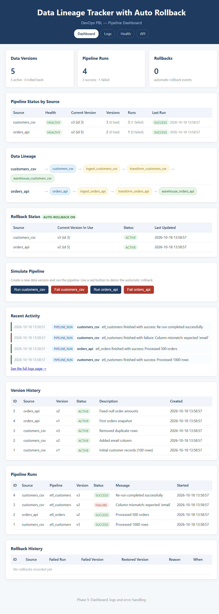
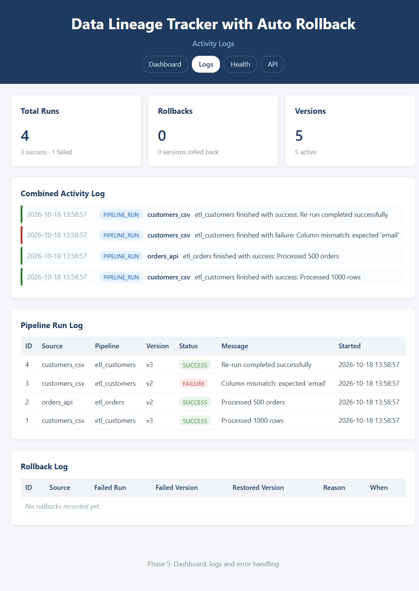

# Data Lineage Tracker with Auto Rollback

A lightweight **DevOps PBL project** that tracks data lineage, keeps a version history of every data source, simulates pipeline runs, and **automatically rolls back to the last successful version** when a pipeline failure occurs.

Built to run comfortably on a modest laptop (Intel i5, 8 GB RAM) — no heavy AI models, no large dependencies. The only Python package required is **Flask**; everything else uses the standard library.

---

## Table of Contents

- [Overview](#overview)
- [Features](#features)
- [Tech Stack](#tech-stack)
- [Architecture](#architecture)
- [Project Structure](#project-structure)
- [Getting Started](#getting-started)
- [Running with Docker](#running-with-docker)
- [Using the Dashboard](#using-the-dashboard)
- [Demo Walkthrough](#demo-walkthrough)
- [API Reference](#api-reference)
- [Database Schema](#database-schema)
- [Testing](#testing)
- [Screenshots](#screenshots)
- [Troubleshooting](#troubleshooting)
- [Roadmap](#roadmap)
- [License](#license)

---

## Overview

Data pipelines change constantly. When a change breaks a pipeline, teams need to know two things quickly:

1. **Where did this data come from?** (data lineage)
2. **Which version was working before?** (rollback)

This project answers both with a small Flask + SQLite web app. A dashboard shows the lineage chain for each data source, summarizes pipeline health, records every run in a version history, and performs an **automatic rollback** the moment a run fails.

---

## Features

| Feature | Description |
|---|---|
| **Lineage tracking** | Each data source has a lineage chain: `source → ingest → transform → warehouse`, stored as nodes and edges in SQLite |
| **Version history** | Every pipeline run creates a new data version; full history is preserved forever |
| **Pipeline simulation** | Runs can succeed or fail (randomly, or forced for a demonstration) |
| **Automatic rollback** | On failure, the tracker restores the last successful version and logs the event with a reason |
| **Rollback status & history** | The dashboard shows the version currently in use per source and the complete rollback log |
| **Activity logs** | Pipeline runs and rollback events in one chronological feed, plus a dedicated logs page |
| **Health endpoint** | `/health` returns JSON status — ready for Docker, Jenkins, and Kubernetes checks |
| **Friendly error handling** | HTML error pages for browsers, JSON errors for API calls, and input validation on every endpoint |
| **Zero heavy dependencies** | Only Flask is installed; SQLite ships with Python |

---

## Tech Stack

| Layer | Technology |
|---|---|
| Frontend | HTML5, CSS3, vanilla JavaScript |
| Backend | Python 3 + Flask |
| Database | SQLite (standard library `sqlite3`, no ORM) |
| Version control | Git + GitHub |
| Containerisation | Docker + Docker Compose |
| CI/CD | Jenkins *(Phase 8)* |
| Orchestration | Kubernetes, optional *(Phase 9)* |

---

## Architecture

```
                              Browser
                                 |
                     HTML pages  |  JSON API
                                 v
                    +--------------------------+
                    |     Flask application    |
                    |        (app.py)          |
                    +--------------------------+
                       |        |         |
              +--------+        |         +---------------+
              |                 |                         |
              v                 v                         v
     +----------------+  +---------------+      +------------------+
     |  pipeline.py   |  |  rollback.py  |      |   templates/     |
     | simulate runs  |  | auto rollback |      |   static/        |
     | build lineage  |  | find last     |      |   (dashboard)    |
     | activity log   |  | good version  |      +------------------+
     +----------------+  +---------------+
              |                 |
              +--------+--------+
                       v
              +--------------------+
              |  database.py       |
              |  (sqlite3 layer)   |
              +--------------------+
                       v
              +--------------------+
              |    lineage.db      |
              | data_versions      |
              | pipeline_runs      |
              | rollback_logs      |
              | lineage_nodes      |
              | lineage_edges      |
              +--------------------+
```

The whole application is packaged as a Docker image — see
[Running with Docker](#running-with-docker).

---

## Project Structure

```
Data-Lineage-Tracker-with-Auto-Rollback/
├── app.py                  # Flask app: pages, JSON API, error handling, logging
├── database.py             # SQLite layer: schema + save/fetch helpers
├── pipeline.py             # Pipeline simulation, lineage building, activity log
├── rollback.py             # Automatic rollback engine
├── seed.py                 # Creates sample demo data (safe to re-run)
├── test_database.py        # Tests for the database layer
├── test_pipeline.py        # Tests for lineage + pipeline simulation
├── test_rollback.py        # Tests for automatic rollback
├── test_app.py             # Tests for pages, API and error handling
├── test_config.py          # Tests for environment-based configuration
├── requirements.txt        # Only: flask
├── Dockerfile              # Container image definition
├── docker-compose.yml      # One-command container setup with a data volume
├── docker-entrypoint.sh    # Seeds demo data (if empty) then starts the app
├── .dockerignore           # Keeps the image and build context small
├── .gitattributes          # Forces LF line endings for shell scripts
├── .gitignore              # Excludes venv, *.db and *.log
├── HANDOFF.md              # Team handoff guide and prompts for the remaining phases
├── docs/
│   └── screenshots/        # Dashboard and logs screenshots
└── templates/
    ├── index.html          # Dashboard page
    ├── logs.html           # Activity logs page
    └── error.html          # Friendly 404/405/500 page
```

---

## Getting Started

### Prerequisites

- Windows, macOS or Linux
- Python 3.9 or newer
- Git

### 1. Clone the repository

```bash
git clone https://github.com/BHAVYA123REDDY/Data-Lineage-Tracker-with-Auto-Rollback.git
cd Data-Lineage-Tracker-with-Auto-Rollback
```

### 2. Create a virtual environment and install Flask

**Windows (PowerShell):**

```powershell
python -m venv .venv
.venv\Scripts\python.exe -m pip install -r requirements.txt
```

**macOS / Linux:**

```bash
python3 -m venv .venv
source .venv/bin/activate
pip install -r requirements.txt
```

### 3. Create the sample data

```powershell
.venv\Scripts\python.exe seed.py
```

Expected output:

```
Seeding sample versions and pipeline runs...
Created 8 new lineage nodes.

Database is ready:
  - 5 data versions
  - 4 pipeline runs
  - 8 lineage nodes
  - 6 lineage edges
  - 0 rollback logs
```

### 4. Run the application

```powershell
.venv\Scripts\python.exe app.py
```

Then open **http://127.0.0.1:5000** in your browser.

> The server must be running for the site to load. Press `Ctrl + C` in the terminal to stop it.
> Set the environment variable `FLASK_DEBUG=1` before starting to enable auto-reload while editing code.

---

## Running with Docker

The whole application is packaged as a small image based on **`python:3.12-slim`**
and runs as a **non-root user**. Nothing else needs to be installed on the machine.

### Option A — Docker Compose (recommended, one command)

```bash
docker compose up -d --build
```

Then open **http://127.0.0.1:5000**.

Useful commands:

```bash
docker compose ps            # check status (should say "healthy")
docker compose logs -f       # follow the application logs
docker compose down          # stop the container (data is kept)
docker compose down -v       # stop and delete the database volume
```

### Option B — plain Docker

```bash
docker build -t data-lineage-tracker:1.0 .
docker run -d --name lineage-tracker -p 5000:5000 -v lineage-data:/app/data data-lineage-tracker:1.0
```

```bash
docker ps                                  # status + health
docker logs lineage-tracker                # startup output
docker exec lineage-tracker python -c "print('inside the container')"
docker stop lineage-tracker && docker rm lineage-tracker
```

### What happens on start-up

`docker-entrypoint.sh` runs `seed.py` first. Seeding is **safe to repeat**: the
sample versions are only inserted when the database is empty, so restarting the
container never duplicates or loses data. Then the Flask app starts and listens
on `0.0.0.0:5000`.

### Configuration with environment variables

| Variable | Default (in the image) | Purpose |
|---|---|---|
| `HOST` | `0.0.0.0` | Interface the web server binds to |
| `PORT` | `5000` | Port the web server listens on |
| `LINEAGE_DB_PATH` | `/app/data/lineage.db` | SQLite file location (put it on a volume) |
| `AUTO_ROLLBACK_ENABLED` | `true` | Set to `false` to see failures **without** rollback |
| `FLASK_DEBUG` | `0` | `1` enables auto-reload (development only) |

Example — run with automatic rollback turned off:

```bash
docker run -d --name lineage-demo -p 5000:5000 -e AUTO_ROLLBACK_ENABLED=false data-lineage-tracker:1.0
```

### Health check

The image contains a `HEALTHCHECK` that calls the `/health` endpoint every
30 seconds, so `docker ps` reports **`(healthy)`** when the app is ready. The same
endpoint will be reused by Jenkins and Kubernetes in the next phases.

```bash
docker inspect --format "{{.State.Health.Status}}" lineage-tracker
```

### Data persistence

The database lives in the named volume **`lineage-data`** mounted at `/app/data`.
Stop and restart the container as often as you like — your versions, runs and
rollback history stay exactly where they were.

---

## Using the Dashboard

| Page | URL | Purpose |
|---|---|---|
| Dashboard | `/` | Summary cards, per-source health, lineage chains, rollback status, simulate buttons, recent activity, version/run/rollback tables |
| Logs | `/logs` | Combined activity feed, full pipeline run log and rollback log |
| Health | `/health` | JSON health check for automation |
| API | `/api/status` | Machine-readable summary |

---

## Demo Walkthrough

A simple script for a college demonstration:

1. **Start the app** and open http://127.0.0.1:5000
2. **Show the lineage** section — each source flows from raw data to a warehouse table
3. **Show the version history** — several versions per source
4. Click **"Run customers_csv"** → a new version is created and the run succeeds
5. Click **"Fail customers_csv"** → the run fails and you will see:
   - the message `Failure -> AUTO ROLLBACK: Rolled back to customers_csv v3`
   - the failed version marked `rolled_back`
   - the **Rollback Status** panel still pointing at the last good version
   - a new entry in **Rollback History**
6. Open the **Logs** page to show the complete chronological audit trail

---

## API Reference

All endpoints return JSON.

| Method | Endpoint | Description |
|---|---|---|
| `GET` | `/health` | Health check: `{"status": "ok", "database": "reachable"}` |
| `GET` | `/api/status` | Summary counts (versions, runs, rollbacks) |
| `GET` | `/api/versions` | All data versions, newest first |
| `GET` | `/api/runs` | All pipeline runs with source and version details |
| `GET` | `/api/lineage` | Lineage chain for every data source |
| `GET` | `/api/rollbacks` | All rollback events with failed/restored versions |
| `GET` | `/api/current` | Version currently in use for each source |
| `GET` | `/api/logs?limit=50` | Combined activity log (pipeline runs + rollbacks) |
| `GET` | `/api/config` | Current configuration (auto-rollback on/off, failure rate) |
| `POST` | `/api/simulate` | Simulate a pipeline run |
| `POST` | `/api/rollback` | Manually roll back a version |

### Simulate a pipeline run

```bash
curl -X POST http://127.0.0.1:5000/api/simulate \
  -H "Content-Type: application/json" \
  -d '{"source_name": "customers_csv", "force_failure": false}'
```

Example response (failure with automatic rollback):

```json
{
  "run_id": 5,
  "source_name": "customers_csv",
  "version_id": 6,
  "version_number": 4,
  "status": "failure",
  "message": "Simulated failure: data quality check did not pass",
  "rolled_back": true,
  "restored_version_id": 3,
  "rollback": {
    "status": "rolled_back",
    "message": "Rolled back to customers_csv v3 (version id 3)"
  }
}
```

### Manual rollback

```bash
curl -X POST http://127.0.0.1:5000/api/rollback \
  -H "Content-Type: application/json" \
  -d '{"version_id": 6, "reason": "demo rollback"}'
```

### Errors

API errors always return JSON with an `error` field:

```json
{ "error": "Unknown source: wrong_name", "valid_sources": ["customers_csv", "orders_api"] }
```

| Status | Meaning |
|---|---|
| `400` | Invalid request (bad JSON, wrong type, unknown source) |
| `404` | Resource not found |
| `405` | Wrong HTTP method |
| `409` | No data sources configured (run `seed.py`) |
| `500` | Unexpected server error (also written to `app.log`) |

---

## Database Schema

SQLite file: `lineage.db` (created automatically, excluded from Git).

**`data_versions`** — every version of a tracked source

| Column | Type | Notes |
|---|---|---|
| `id` | INTEGER | Primary key |
| `source_name` | TEXT | e.g. `customers_csv` |
| `version_number` | INTEGER | Per source, starting at 1 |
| `description` | TEXT | What changed |
| `status` | TEXT | `active`, `failed` or `rolled_back` |
| `created_at` | TEXT | Timestamp |

**`pipeline_runs`** — every pipeline execution

| Column | Type | Notes |
|---|---|---|
| `id` | INTEGER | Primary key |
| `pipeline_name` | TEXT | e.g. `customers_csv_pipeline` |
| `version_id` | INTEGER | Foreign key → `data_versions.id` |
| `status` | TEXT | `success` or `failure` |
| `message` | TEXT | Human readable result |
| `started_at` / `finished_at` | TEXT | Timestamps |

**`rollback_logs`** — every automatic or manual rollback

| Column | Type | Notes |
|---|---|---|
| `id` | INTEGER | Primary key |
| `failed_run_id` | INTEGER | Foreign key → `pipeline_runs.id` |
| `rolled_back_to_version_id` | INTEGER | Foreign key → `data_versions.id` |
| `reason` | TEXT | Why the rollback happened |
| `created_at` | TEXT | Timestamp |

**`lineage_nodes`** — graph nodes (`source`, `step`, `output`) and **`lineage_edges`** — directed connections between them.

---

## Testing

The project has **122 tests** across five files. Each test uses a temporary database, so your real data is never modified.

```powershell
.venv\Scripts\python.exe test_database.py    # 10 tests
.venv\Scripts\python.exe test_pipeline.py    # 23 tests
.venv\Scripts\python.exe test_rollback.py    # 21 tests
.venv\Scripts\python.exe test_app.py         # 45 tests
.venv\Scripts\python.exe test_config.py      # 23 tests
```

The same tests can run inside the container (this is what the Jenkins pipeline will do in Phase 8):

```bash
docker run --rm data-lineage-tracker:1.0 python test_pipeline.py
```

All tests print `[PASS]`/`[FAIL]` per check and exit with code `0` when everything passes:

```
Results: 45 passed, 0 failed
```

Covered behaviour includes lineage idempotency, per-source version numbering, automatic rollback on failure, no-target rollback on a first-run failure, rollback history accuracy, API validation errors, HTML/JSON error handling, and environment-variable configuration (`LINEAGE_DB_PATH`, `AUTO_ROLLBACK_ENABLED`).

---

## Screenshots

### Dashboard



### Activity logs



---

## Troubleshooting

| Problem | Cause | Fix |
|---|---|---|
| "Site can't be reached" | The Flask server is not running | Start it with `.venv\Scripts\python.exe app.py` and keep the terminal open |
| `python: command not found` | Python is not on PATH | Reinstall Python and tick **"Add Python to PATH"** |
| No data on the dashboard | The database has not been seeded | Run `.venv\Scripts\python.exe seed.py` |
| `ModuleNotFoundError: flask` | Flask is not installed in the virtual environment | Run `.venv\Scripts\python.exe -m pip install -r requirements.txt` |
| Port 5000 already in use | Another process is using the port | Close the other app or change the port in `app.py` |
| Strange file-lock errors on Windows | Project stored inside a synced folder (OneDrive) | Keep the project in a local folder such as `C:\Users\<you>\Projects\` |
| `failed to connect to the docker API ... is the daemon running` | Docker Desktop is installed but not started | Launch **Docker Desktop** and wait until the whale icon says *Engine running*, then retry |
| `port is already allocated` on `docker run` | Something else already uses host port 5000 | Stop the other process, or publish a different port: `-p 8080:5000` |
| Container starts then stops immediately | Entrypoint error — usually a CRLF line ending in a `.sh` file | `.gitattributes` forces LF; make sure it was not edited on Windows |

---

## Roadmap

| Phase | Status | Description |
|---|---|---|
| 1 | ✅ Done | Inspect setup, create minimal Flask website |
| 2 | ✅ Done | SQLite database and version history |
| 3 | ✅ Done | Data lineage tracking and simulated pipeline updates |
| 4 | ✅ Done | Automatic rollback to the last successful version |
| 5 | ✅ Done | Dashboard, logs and error handling improvements |
| 6 | ✅ Done | README and project documentation |
| 7 | ✅ Done | Docker image, Compose setup, health check and data volume |
| 8 | Planned | Jenkins CI/CD pipeline |
| 9 | Optional | Kubernetes deployment if practical on the laptop |

---

## License

This project is released under the MIT License — see [LICENSE](LICENSE).
